# effect-sql-pg-boss for Dummies

A guided tour of pg-boss, the Effect SQL stack, and why this library has to exist between them.

You do not need to know pg-boss to read this. Each chapter builds on the one before. The code references point at this repository (`packages/effect-sql-pg-boss/src/...`) and at the installed dependencies (`packages/effect-sql-pg-boss/node_modules/...`).

**Contents**

1. [The short answer](#1-the-short-answer)
2. [pg-boss: a job queue that lives in Postgres](#2-pg-boss-a-job-queue-that-lives-in-postgres)
3. [How pg-boss talks to the database: the `Db` seam](#3-how-pg-boss-talks-to-the-database-the-db-seam)
4. [Postgres has two ways to send a query](#4-postgres-has-two-ways-to-send-a-query)
5. [Effect SQL: `SqlClient`, connections and transactions](#5-effect-sql-sqlclient-connections-and-transactions)
6. [`@effect/sql-pg`: the native Postgres driver](#6-effectsql-pg-the-native-postgres-driver)
7. [Listeners: three different things with one name](#7-listeners-three-different-things-with-one-name)
8. [Two drivers side by side](#8-two-drivers-side-by-side)
9. [Why effect-sql-pg-boss exists](#9-why-effect-sql-pg-boss-exists)
10. [How the library works inside](#10-how-the-library-works-inside)
11. [Two walkthroughs, statement by statement](#11-two-walkthroughs-statement-by-statement)
12. [Reading the code](#12-reading-the-code)
13. [Glossary](#13-glossary)

---

## 1. The short answer

Yes, it is about transactions. Multi-statement SQL is the obstacle that makes it hard.

Your app writes its own tables with Effect's SQL client. It also wants a job queue, pg-boss, in the same database. Two things must be atomic:

1. **Enqueue inside the app's transaction.** "Insert the order and enqueue the charge-card job" must commit together or not at all. If the order rolls back, the job must not exist.
2. **Write app tables inside pg-boss's transaction.** When a worker processes a job, "update the order and mark the job completed" must commit together. If the handler fails, its writes must roll back and the job must be retried.

pg-boss supports both, but only through its own small database interface. Effect's Postgres driver does not fit that interface out of the box, mostly because pg-boss sometimes sends several SQL statements in one string and the Effect driver refuses to. `effect-sql-pg-boss` is the adapter that makes them fit, plus an Effect-style API on top (Schema payloads, layers, typed errors).

The rest of this book explains each word in those paragraphs.

---

## 2. pg-boss: a job queue that lives in Postgres

### What a job queue is

A job queue lets one part of a program say "do this later" and another part do it. The first part is the **producer**. It **sends** a **job**: a queue name plus a small JSON payload. The second part is the **worker**. It **fetches** jobs from a queue, runs a **handler** on them, and reports whether each one succeeded.

Most job queues keep jobs in Redis or a message broker. pg-boss keeps them in ordinary Postgres tables. That is the whole trick, and it is why transactions matter: a job is just a row, so inserting it can be part of the same transaction as inserting your order.

### The tables

On `boss.start()`, pg-boss creates (or migrates) its own schema, `pgboss` by default. The two tables you care about:

- `pgboss.queue`: one row per queue, with its options (retry limit, expiration, policy, dead-letter queue).
- `pgboss.job`: one row per job, with `name` (the queue), `data` (the payload), `state`, retry counters, timestamps and `output`.

### A job's life

A job is a row whose `state` column moves through a small state machine. It starts simple:

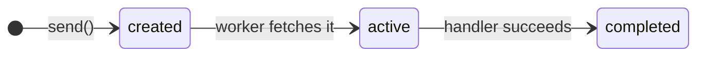

When the handler fails, pg-boss retries until the queue's `retryLimit` runs out:

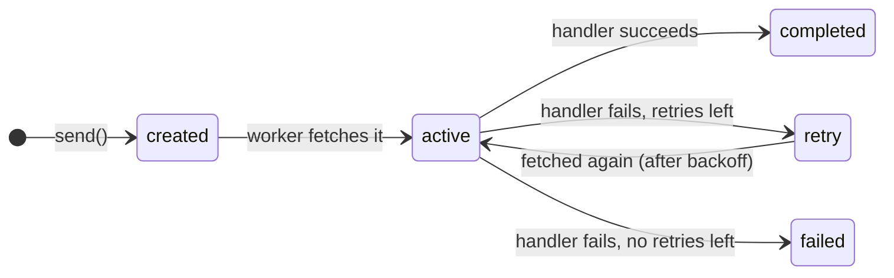

Finally, a job can be cancelled, and a failed job can be copied to a **dead-letter queue** so a separate handler can deal with it:

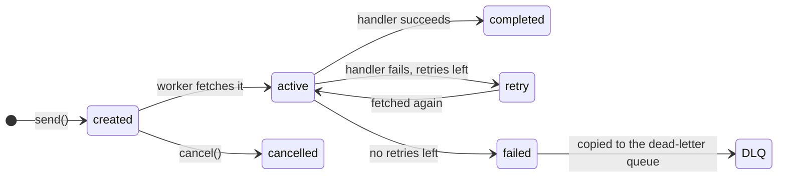

A job that stays `active` longer than its expiration is treated as failed. That covers a worker process that crashed mid-job: nobody will ever report back, so pg-boss gives up waiting and retries.

### How a worker gets jobs

Two words first. The **handler** is your function: it gets a batch of jobs and does the work. The **worker** is pg-boss's machinery around it: it fetches jobs, calls the handler, and records the result. Your handler does not fetch jobs, and it does not need to change their state.

`boss.work(queue, options, handler)` creates `localConcurrency` workers (1 by default), starts them, and returns at once with a worker id. It does not block and returns no rows. Each worker is a timer-driven task in your Node process, not a `while (true)` loop. Node's event loop runs it alongside everything else your process does. Each worker repeats four steps on its own timer:

1. Fetch up to `batchSize` jobs with one SQL statement (below).
2. If any came back, call the handler with them and wait for it to finish.
3. Mark the jobs `completed`, `retry` or `failed`.
4. Wait for the next polling interval (2 seconds by default), then start again.

The fetch statement roughly says:

```sql
UPDATE pgboss.job SET state = 'active', started_on = now()
WHERE id IN (
  SELECT id FROM pgboss.job
  WHERE name = $1 AND state < 'active' AND start_after < now()
  ORDER BY priority DESC, created_on
  LIMIT $2
  FOR UPDATE SKIP LOCKED
)
RETURNING *
```

`LIMIT $2` is `batchSize`, and the rows that come back are a **batch**.

### The handler gets the whole batch

pg-boss calls the handler once per batch, with all of the batch's jobs in one array. It never calls the handler once per job:

```ts
boss.work("charge-card", { batchSize: 10 }, async (jobs) => {
	// jobs is an array of up to 10 jobs, all from one fetch
	for (const job of jobs) {
		// ...
	}
})
```

`batchSize` defaults to 1, so by default the array holds one job, which can look like "one job per call". With `batchSize: 10`, one call gets up to ten jobs, and looping over them is the handler's job. That is why the examples in this book have `for (const job of jobs)`.

The batch is also the unit pg-boss settles. When the handler resolves, pg-boss marks every job in the batch `completed`. When it rejects, every job in the batch goes to `retry` or `failed`, including the ones the handler had already finished. In a transactional worker the whole batch shares one transaction, so a failure on job 7 also rolls back the writes for jobs 1 to 6.

This library keeps that shape. A `JobQueue` worker's handler gets a `NonEmptyReadonlyArray<Job<A>>`: the decoded batch, never empty.

### Many workers, one table

`FOR UPDATE SKIP LOCKED` is what makes Postgres a good queue. Ten workers can run the fetch at once, in one process or spread over several machines, and each one skips the rows another worker has locked, so no job is handed out twice.

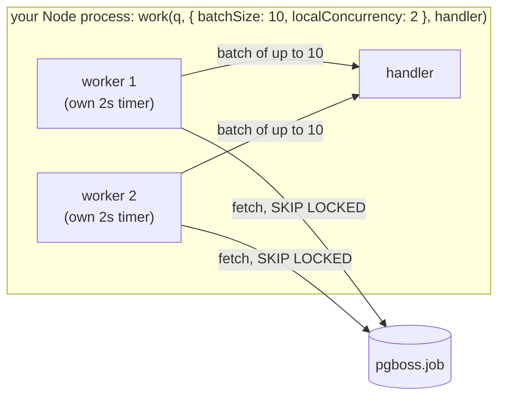

So `batchSize` sets how many jobs one fetch claims, and `localConcurrency` sets how many workers fetch in parallel. With the values above, at most 2 batches of 10 run at once in this process. A second process running the same `work` call adds two more workers on the same table.

### The pieces of pg-boss you will meet in this repo

| Concept                                  | What it is                                                                                                                                                                                                                      |
| ---------------------------------------- | ------------------------------------------------------------------------------------------------------------------------------------------------------------------------------------------------------------------------------- |
| `send(name, data, opts)`                 | Inserts one job row. Returns its id, or `null` when a policy drops it.                                                                                                                                                          |
| `work(name, opts, fn)`                   | Starts polling a queue and calls `fn(jobs)` per batch.                                                                                                                                                                          |
| `offWork(name)`                          | Stops a worker. `wait: true` waits for the batch in flight.                                                                                                                                                                     |
| `createQueue`, `updateQueue`, `getQueue` | Manage rows in `pgboss.queue`. A queue must exist before you send to it.                                                                                                                                                        |
| Policies                                 | `standard`, `short`, `singleton`, `stately` and others. They limit how many jobs of a queue may wait or run at once. A `singleton` queue drops a `send` while a job is already waiting, which is why `send` can return nothing. |
| `flow(jobs)`                             | Inserts several jobs plus dependency edges in one go: "run `ship` after `charge` completes". Dependent jobs wait until their parents finish.                                                                                    |
| Dead-letter queue                        | A queue named in another queue's `deadLetter` option. Jobs that fail for good are copied there.                                                                                                                                 |
| Schedules                                | Cron-style recurring sends. Not wrapped by this library; reach them through `PgBoss.use`.                                                                                                                                       |
| Maintenance                              | A timer inside pg-boss that expires stuck jobs, deletes old ones and moves things along.                                                                                                                                        |
| Migrations and BAM                       | `start()` installs or upgrades pg-boss's schema. BAM is pg-boss's runner for slow background migrations (for example index builds) that run after start.                                                                        |
| Events                                   | pg-boss is an `EventEmitter`. It emits `error` and `warning`. The library forwards both to Effect's logger.                                                                                                                     |

---

## 3. How pg-boss talks to the database: the `Db` seam

pg-boss never imports a specific driver into its logic. It talks to the database through one small interface, `IDatabase`, exported as `Db` (`node_modules/pg-boss/dist/types.d.ts`):

```ts
interface IDatabase {
	executeSql(text: string, values?: unknown[]): Promise<{ rows: any[] }>
	beginTransaction?(): Promise<TransactionHandle> // optional
	listen?(channel, onNotification, onReconnect): Promise<ListenHandle> // optional
}

interface TransactionHandle {
	db: IDatabase // run statements inside the transaction
	commit(): Promise<void>
	rollback(): Promise<void> // never rejects, must be bounded in time
}
```

That is the entire contract between pg-boss and a database driver. If you give pg-boss nothing, it builds its own `Db` on a node-postgres (`pg`) pool from the connection string you pass. If you give it a `db` in the constructor, it uses yours for everything.

There are two places a `Db` shows up, and keeping them apart is half of understanding this library.

### Place 1: the constructor `db`, which pg-boss uses for itself

```ts
new PgBoss({ db: myDb })
```

pg-boss runs all of its own work through this: migrations, maintenance, polling (`fetch`), completing and failing jobs of normal workers, and opening transactions for transactional workers (`beginTransaction`). Some of those statements are long scripts with several statements and no parameters.

Most apps never pass a constructor `db`. They pass a connection string, and the built-in node-postgres pool is pg-boss's normal setup. You pass your own when you need control over how pg-boss reaches the database:

1. **You already have a pool and do not want a second one.** An app on Knex, Kysely or postgres.js wraps its existing client as `{ executeSql }`. pg-boss then shares the app's connections and settings (SSL, rotating cloud auth tokens, a pooler) instead of opening its own.
2. **You want to see or shape every statement pg-boss sends**: logging, metrics, tracing, or a fake `db` in tests.
3. **You want transactional workers to open their transaction through your own transaction system.** pg-boss calls the constructor `db`'s `beginTransaction()` for every batch. If it is yours, you decide what "open a transaction" means.

This library passes its own for reason 3. Every worker transaction must be a real Effect `sql.withTransaction` on your `PgClient` (the parked transaction, chapter 10.6), because that is the only way your Effect code inside the handler sees the transaction. A little of reason 1 applies too: the maintenance pool is built from `PgClient.config`, so you configure the database once.

A custom `db` takes on duties the built-in one already handles:

- **`executeSql` must run multi-statement scripts without parameters**, because migrations and maintenance send them. That is why this library cannot point `executeSql` at the native client and uses the node-postgres maintenance pool instead.
- **Without `beginTransaction`, there are no transactional workers.** `work(..., { transactional: true })` fails an assert: "transactional workers require ... a db adapter implementing beginTransaction" (`manager.js:1170`).
- **Without `listen`, there is no `useListenNotify`.** pg-boss falls back to polling, which is where this library is today (chapter 7.3).

### Place 2: the per-call `{ db }`, which joins your transaction

Almost every pg-boss method takes an options object with an optional `db`:

```ts
await boss.send("charge-card", { orderId: 42 }, { db: myTransactionDb })
```

This means "run this one call on that connection instead of your own". If `myTransactionDb` runs statements inside an open transaction, the job insert becomes part of that transaction. This is how pg-boss supports direction 1 from chapter 1. pg-boss sends no `BEGIN` or `COMMIT` here. The caller owns the transaction.

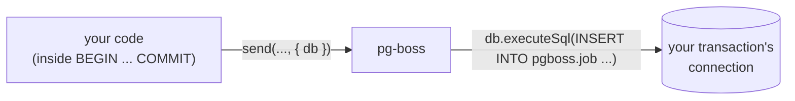

### Transactional workers

pg-boss 12 added `work(name, { transactional: true }, (jobs, tx) => ...)`. For each batch, pg-boss:

1. calls `beginTransaction()` on its constructor `db` and gets a handle,
2. calls your handler with the batch and `tx`, the handle's `db`,
3. marks the jobs completed through `tx` and then calls `commit()`, or calls `rollback()` if anything failed.

Your handler writes its own rows through `tx`, so they commit together with the job's completion. That is direction 2.

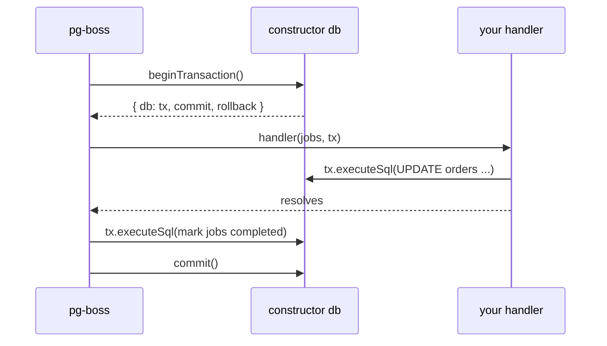

One detail matters later. pg-boss tracks "which jobs does this transaction own" by the **identity** of the `tx` object. If your handler calls `boss.send(..., { db: tx })`, pg-boss recognises `tx` and knows the call belongs to the batch. If you wrap `tx` in a new object, pg-boss sees a stranger and the batch's bookkeeping breaks. So whatever runs inside the handler must pass pg-boss the exact object pg-boss handed out.

### Can the constructor `db` and the per-call `db` be the same object?

They have the same type, `IDatabase`, but they answer different questions, so in practice they are different objects.

- **The constructor `db` is a pool.** It lives as long as pg-boss runs. Each `executeSql` may land on any free connection and commits on its own. pg-boss's polling and maintenance need exactly that: a fetch must commit at once, or no other worker would see that the jobs are taken.
- **The per-call `db` is one connection inside one open transaction.** It lives from `BEGIN` to `COMMIT`. Its whole point is that statements on it do not commit on their own.

Swapping them goes wrong in both directions:

- **The constructor `db` passed as a per-call `db`** works but does nothing. It is the same as leaving `{ db }` out: the `send` runs on a pool connection and commits at once, outside your transaction.
- **A transaction `db` passed as the constructor `db`** breaks pg-boss. Its polling, maintenance and job completions would all run inside your transaction and commit only when you commit. Other workers would see none of it, and the transaction would stay open for as long as pg-boss runs.

The two meet in one place. The constructor `db`'s `beginTransaction()` returns a handle, and the handle's `db` is a per-call `db`. That is the `tx` a transactional worker passes to your handler. In this library:

```
constructor db = {
  executeSql:       → maintenance pool (node-postgres)      // pg-boss's own work
  beginTransaction: → parked withTransaction on PgClient    // returns { db: dbFor(conn), ... }
}

per-call db       = dbFor(conn)   // conn = the fiber's current Effect transaction connection
```

So the worker's `tx` and the `db` a `send` uses inside `sql.withTransaction` are built the same way, by `dbFor(conn)`. Inside a worker they are the same object, which is why a `send` inside a handler joins the worker's transaction (chapter 10.6).

---

## 4. Postgres has two ways to send a query

This chapter is short, and it explains the single biggest obstacle.

A Postgres client talks to the server over the **wire protocol**, a stream of typed messages over a socket. There are two ways to run a query.

**The simple query protocol.** The client sends one `Query` message containing SQL text. The text may contain several statements separated by `;`. The server runs them in order and sends results back. There are no parameters, so values must be written into the text.

**The extended query protocol.** The client sends `Parse` (here is the SQL, with `$1`, `$2` placeholders), `Bind` (here are the values), and `Execute`. The server can keep the parsed statement and reuse it next time, which is a **prepared statement**. Values travel separately, so there is no SQL injection risk and no quoting. The catch: one `Parse` may contain only **one** statement. Send two and Postgres answers:

```
cannot insert multiple commands into a prepared statement
```

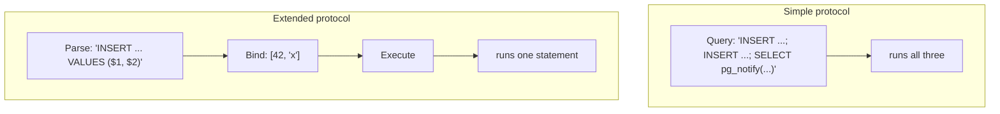

node-postgres (`pg`) chooses for you. `client.query(text)` with no values uses the simple protocol. `client.query(text, values)` uses the extended one. pg-boss relies on that: its migration and maintenance scripts, and `flow` when called with `{ db }`, are multi-statement strings sent without values.

---

## 5. Effect SQL: `SqlClient`, connections and transactions

In Effect 4, the SQL core lives in the main `effect` package under `effect/sql` (`node_modules/effect/src/sql/`). Drivers such as `@effect/sql-pg` plug into it. This chapter covers the core, the part every driver shares.

### `SqlClient` is a tagged template

```ts
const sql = yield* SqlClient.SqlClient
const rows = yield* sql<{ id: bigint }>`select id from orders where status = ${status}`
```

`sql` is a service you get from the Effect context. Calling it as a template builds a **statement**, an Effect that runs the query when you `yield*` it. `${status}` becomes a parameter (`$1`), not text. Helpers such as `sql.insert(obj)`, `sql.in(list)` and `sql.unsafe(text)` build fragments. On top of this sit `SqlSchema` (decode rows with a Schema), `SqlModel` (repositories from a Schema class) and `Migrator` (run numbered migration files). You use them; the library does not touch them.

### The `Connection` interface

Underneath, a driver implements `Connection` (`effect/src/sql/SqlConnection.ts`). The methods that matter here:

- `execute(sql, params)`: run a statement, prepared and cached when the driver supports it.
- `executeUnprepared(sql, params)`: run a statement without caching the prepared form.
- `executeRaw(sql, params)`: like the above but returns the driver's raw result.
- `executeStream(...)`: stream rows.

Every `sql` template ends up calling one of these on some connection. Which connection is the next question.

### `withTransaction` and the transaction service

```ts
yield* sql.withTransaction(Effect.gen(function*() {
	yield* sql`insert into orders ...`
	yield* sql`insert into order_lines ...`
}))
```

Here is what `withTransaction` does (`SqlClient.ts`, `makeWithTransaction`):

1. Check the fiber's context for `sql.transactionService`. It is a `Context.Service` whose value is a pair `[connection, depth]`.
2. If it is absent, take a connection out of the pool and reserve it (no one else may use it), send `BEGIN`, and run the body with `transactionService = [conn, 0]` added to the context.
3. If it is present, this is a nested call. Send `SAVEPOINT effect_sql_<n>` on the same connection and run the body with `[conn, n]`.
4. When the body succeeds, send `COMMIT` (or `RELEASE SAVEPOINT`). When it fails or is interrupted, send `ROLLBACK` (or `ROLLBACK TO SAVEPOINT`).
5. Give the connection back to the pool.

And every statement asks the same question first (`SqlClient.make`, `getConnection`):

```ts
const getConnection = Effect.flatMap(
	Effect.serviceOption(transactionService),
	Option.match({
		onNone: () => options.acquirer, // any pool connection
		onSome: ([conn]) => Effect.succeed(conn) // the transaction's connection
	})
)
```

So "being in a transaction" in Effect is not a global flag and not a thread-local. It is a value in the fiber's context. Any code that runs in that fiber, or in a child fiber that inherits its context, automatically sends its statements down the transaction's connection.

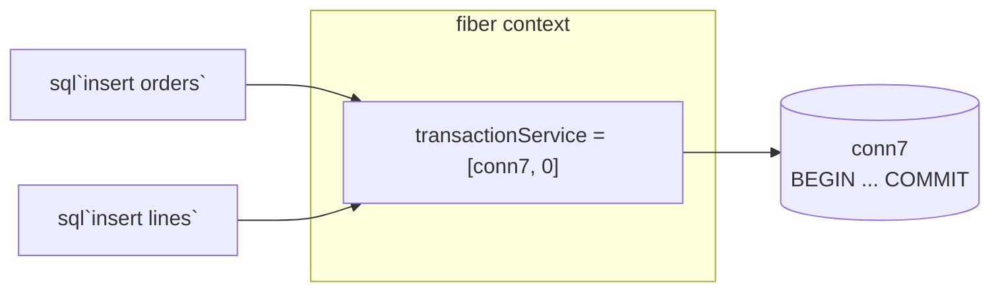

This one idea is what the library leans on most. If you can find `transactionService` in the current fiber, you can find the connection of the current transaction, and you can hand pg-boss a `Db` that writes on it.

### What the design found broken

You might think you could let pg-boss open the transaction and then put `[pgBossConnection, 0]` into `transactionService` yourself. The design tried that. A nested `withTransaction` then dies with `Service not found: effect/sql/SqlClient/TransactionSemaphore/<n>`, because `withTransaction` also expects a private semaphore that only it installs. That is why the library never fakes a transaction. It always lets `withTransaction` open a real one (chapter 10).

---

## 6. `@effect/sql-pg`: the native Postgres driver

`@effect/sql-pg` implements `SqlClient` for Postgres. In version 4.0.5 it is a **native** driver: it speaks the wire protocol itself (`PgProtocol.ts`, `PgConnection.ts`) and manages its own pool (`PgPool.ts`). It does not use node-postgres. Before Effect PR #7426 it was a thin wrapper over node-postgres; that PR replaced it and listed "query strings must contain one statement" as a breaking change.

### What `PgClient` adds on top of `SqlClient`

`PgClient` (`node_modules/@effect/sql-pg/src/PgClient.ts`) is a `SqlClient` with a few extras:

```ts
interface PgClient extends SqlClient {
	readonly config: PgClientConfig // the options it was built with
	readonly json: (value: unknown) => Fragment // a jsonb parameter
	readonly listen: (channel: string) => Effect<Queue.Dequeue<Notification, SqlError>, SqlError, Scope>
	readonly notify: (channel: string, payload: string) => Effect<void, SqlError>
}
```

`PgClient.layer(...)` provides the same instance under both tags, `PgClient.PgClient` and `SqlClient.SqlClient`. Your repositories ask for `SqlClient`; the library asks for `PgClient` because it needs `config`. They get the same object, and so they share one `transactionService`. The library depends on that.

### How it runs a query

Every query path sends `Parse`, `Bind` and `Execute`, the extended protocol. With `prepare: true` (the default) the parsed statement gets a name and is cached per connection, so repeated queries skip parsing. With `prepare: false` it uses the unnamed statement. Either way it is still `Parse`. There is no encoder for the simple `Query` message, so no option makes it accept `"a; b; c"`. The design proved this across nine query modes (experiment E1 in `design/README.md`).

### Connections and the pool

`PgClient.make` builds a pool. It has three ways of getting a connection, and they explain the pool arithmetic later:

| Acquirer              | Used for            | Exclusive?                                                                    |
| --------------------- | ------------------- | ----------------------------------------------------------------------------- |
| `acquirer` / borrower | ordinary statements | No. With `multiplex: true` several fibers pipeline queries on one connection. |
| `transactionAcquirer` | `withTransaction`   | Yes. The connection is reserved until COMMIT or ROLLBACK.                     |
| `listenAcquirer`      | `listen(channel)`   | Yes. Reserved for as long as the listener's scope is open.                    |

`maxConnections` caps the pool (10 when unset). `PgClient.makeClient` is the single-connection variant; every transaction pins that one connection.

### How rows come back

The native driver decodes types its own way. `int8` columns arrive as `bigint`. Timestamps arrive as epoch milliseconds. node-postgres returns `int8` as a string and timestamps as `Date`. This is why the design refused to move the app onto node-postgres: every row type in the app would change. You also see it in a warning on `PgBoss.use`: a pg-boss read inside a transaction returns rows decoded by the native driver, so timestamps are numbers, not `Date`.

---

## 7. Listeners: three different things with one name

"Listener" means three unrelated things in this codebase. That is probably why it is confusing.

### 7.1 Postgres `LISTEN`/`NOTIFY`, the pub/sub built into Postgres

Postgres has a tiny publish/subscribe system:

- `LISTEN my_channel` on a connection subscribes **that connection** to a channel.
- `NOTIFY my_channel, 'payload'`, or `SELECT pg_notify('my_channel', 'payload')`, from any connection publishes a message.
- Every connection currently listening on the channel receives an asynchronous `NotificationResponse` message on its socket.

Two rules make it tricky. A subscription belongs to one session, so the listening connection must stay open and must not go back to a pool where someone else would get it. And a `NOTIFY` inside a transaction is delivered only when that transaction commits, which is useful: listeners never hear about rows that rolled back.

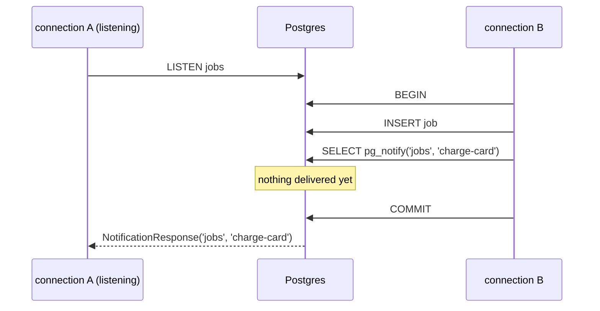

### 7.2 `PgClient.listen`, the Effect wrapper over it

```ts
const program = Effect.scoped(Effect.gen(function*() {
	const pg = yield* PgClient.PgClient
	const notifications = yield* pg.listen("jobs") // resolves after Postgres confirms LISTEN
	while (true) {
		const n = yield* Queue.take(notifications) // { channel, payload, ... }
		yield* Effect.log("got", n.payload)
	}
}))
```

`listen` reserves a connection through `listenAcquirer`, sends `LISTEN`, and gives you a `Queue` that fills with notifications. The connection stays reserved until the surrounding `Scope` closes; then it sends `UNLISTEN` and returns the connection. If the connection dies, the queue fails with the `SqlError`. `notify(channel, payload)` runs `SELECT pg_notify($1, $2)`.

Note the cost: each open `listen` holds one pool connection for its whole life.

### 7.3 pg-boss's `useListenNotify` and the optional `Db.listen`

Polling every two seconds means a job can wait up to two seconds before a worker sees it. pg-boss can do better. With `useListenNotify: true`, `send` adds a `pg_notify` to its insert, and pg-boss keeps one `LISTEN` connection open. A notification wakes the matching workers at once. Polling still runs as a slower backstop.

pg-boss reaches `LISTEN` through the optional `listen` method of its constructor `db` (chapter 3). Its built-in `Db` implements it with a dedicated node-postgres client that reconnects and heartbeats. A custom `Db` that lacks `listen` gets polling only, plus a warning if you asked for `useListenNotify`.

This library's constructor `db` has `executeSql` and `beginTransaction`, but no `listen`. So today **workers poll**. Wiring `Db.listen` to `PgClient.listen` is open decision 5 in `design/README.md`.

### 7.4 And the fourth, which is not about Postgres at all

`internal/housekeeping.ts` has `pool.on("error", ...)` and `client.on("error", ...)`. These are Node `EventEmitter` listeners. A node-postgres connection that drops while idle emits `error`. With no listener attached, Node treats it as an unhandled error and crashes the process. The library attaches one that logs a warning through Effect's logger. `boss.on("error", ...)` and `boss.on("warning", ...)` in `PgBoss.ts` are the same kind of thing: forwarding pg-boss's events to Effect logs.

---

## 8. Two drivers side by side

There are now two Postgres drivers in the picture. Here they are next to each other.

|                        | node-postgres (`pg`)                   | `@effect/sql-pg` 4.0.5 (native)             |
| ---------------------- | -------------------------------------- | ------------------------------------------- |
| Who uses it by default | pg-boss                                | your app                                    |
| API style              | Promises, `client.query(text, values)` | Effects, `sql` templates, `Connection`      |
| Multi-statement text   | Yes, when no values are passed         | No, never                                   |
| `int8`                 | string                                 | `bigint`                                    |
| timestamps             | `Date`                                 | epoch milliseconds                          |
| Transaction            | `BEGIN` on a checked-out client        | `withTransaction`, tracked in fiber context |
| `LISTEN`               | dedicated client in pg-boss's `Db`     | `PgClient.listen`, scoped                   |

And here is what pg-boss needs from a `Db`, checked against what the native client can do:

| pg-boss path                                           | Statements                                         | Native client can run it?           |
| ------------------------------------------------------ | -------------------------------------------------- | ----------------------------------- |
| `send`, `fetch`, `complete`, `fail`, ... with `{ db }` | one statement with values                          | Yes                                 |
| `flow` with `{ db }`                                   | several statements, no values, joined with `";\n"` | No                                  |
| migrations, maintenance, BAM (constructor `db`)        | long scripts, some with `$$` function bodies       | No                                  |
| transactional worker `tx`                              | whatever your handler sends                        | Yes, if `tx` is a native connection |

The left column of that table is exactly the shape of the library.

---

## 9. Why effect-sql-pg-boss exists

Put chapters 3 to 8 together and the problem has four parts.

**Problem 1: direction 1 needs a `Db` on the Effect transaction's connection.** To make `send` join `sql.withTransaction`, someone must find the current transaction connection and wrap it as `{ executeSql }`. Effect knows where that connection is (`transactionService`). pg-boss knows nothing about Effect. Something has to bridge them.

**Problem 2: `flow` with `{ db }` sends multi-statement text.** That text cannot run on the native connection. Someone has to split it.

**Problem 3: pg-boss's own scripts need the simple protocol.** Migrations and maintenance cannot run on the native client at all. Someone has to provide a second, node-postgres-based `Db` for them.

**Problem 4: direction 2 needs the worker's transaction to be an Effect transaction.** If pg-boss opens the transaction on its own node-postgres client, your Effect code cannot use it: `sql` templates look for `transactionService`, and faking it is broken (chapter 5). So the worker transaction must be opened by Effect's `withTransaction` on the app's `PgClient`, and then handed to pg-boss as if pg-boss had opened it.

On top of the plumbing, the library gives you an Effect-native API:

- a queue is a class with a Schema payload (`JobQueue.Service`), so `send` takes a typed value and the handler gets decoded jobs,
- queues are created and converged when their `Layer` builds,
- workers are `Layer`s, so they start and stop with your app,
- failures are typed: `SqlError` subtypes such as `UniqueViolation` stay matchable, everything else is a `PgBossError`,
- `flow` refs are checked at compile time.

---

## 10. How the library works inside

This chapter builds the whole system one piece at a time.

### 10.1 Start: the app and its pool

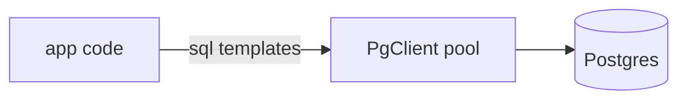

### 10.2 Add pg-boss with a maintenance pool (problem 3)

`PgBoss.layer` (`src/PgBoss.ts`) builds a second, small node-postgres pool from the same `PgClient.config` (`src/internal/housekeeping.ts`, 4 connections by default). It becomes the `executeSql` of pg-boss's constructor `db`. pg-boss's migrations, maintenance, BAM, polling and the settles of non-transactional workers run here. App rows never travel through it.

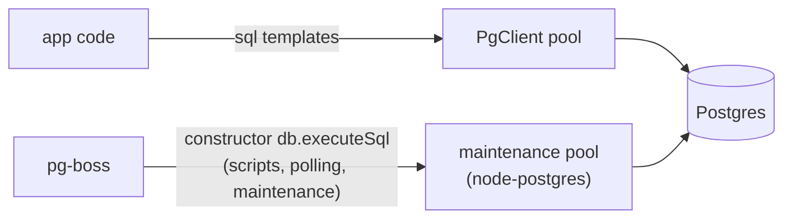

The separate pool has a second benefit. Transactional handlers hold `PgClient` connections for a long time. If pg-boss's polling shared that pool, busy handlers could starve it.

### 10.3 Add the routing rule (problem 1)

`src/internal/connection.ts` holds one rule: **a pg-boss call made from a fiber runs on that fiber's current Effect transaction connection.**

- `currentDb(sql)` reads `sql.transactionService` from the fiber's context. If there is a `[conn, depth]`, it returns `dbFor(conn)`.
- `dbFor(conn)` wraps the native `Connection` as a pg-boss `Db` whose `executeSql` calls `conn.executeUnprepared(text, values)`. It caches the wrapper in a `WeakMap<Connection, Db>`, so one transaction always yields the **same** `Db` object. That satisfies pg-boss's identity rule from chapter 3.
- `withDb(sql, f)` calls `f(db)` with the current transaction's `Db`. If the fiber is not in a transaction, it opens one with `sql.withTransaction` first. So a bare `ChargeCard.send(...)` still runs atomically on its own.

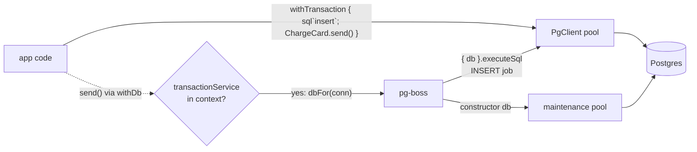

Why `executeUnprepared` on the raw `Connection`, not `sql.unsafe`? Because `sql` applies your app's row transforms. If the app sets `transformResultNames: camelCase`, pg-boss would get `createdOn` instead of the `created_on` it reads. Talking to the `Connection` gives pg-boss untouched rows.

### 10.4 Add the `flow` split (problem 2)

When `executeSql` is called with `values === undefined`, the text is a script. On a `{ db }` path only `flow` sends one. `runScript` splits it on `";\n"`, the exact separator pg-boss joins with, and runs the parts in order on the same connection. Splitting on plain `;` would be wrong in general: pg-boss's migration scripts contain `$$ ... $$` function bodies full of semicolons. That is safe here only because migrations never reach this path; they go to the maintenance pool.

This is the one place the library depends on a pg-boss internal, which is why the peer dependency is pinned to `~12.38` and a test fails if the statement count of a known flow changes.

### 10.5 Add error mapping

pg-boss inspects driver errors. It checks SQLSTATE codes such as `23505` (unique violation) and `25P02` (transaction aborted). The native client wraps those in a `SqlError`. So the `Db` rejects with the driver's original `Error`, which still has `code`, `constraint` and `detail`, and remembers in a `WeakMap` which `SqlError` it came from. When the pg-boss call rejects, `Connection.call` looks the error up and fails your Effect with the original typed `SqlError`. Anything else becomes a `PgBossError`.

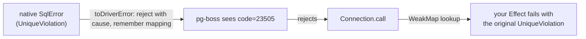

### 10.6 Add the parked transaction (problem 4)

This is the clever part, in `src/internal/workerTransaction.ts`.

pg-boss wants to call `beginTransaction()` and later `commit()` or `rollback()`, from plain Promise code. Effect's `withTransaction` wants to wrap a body: open, run the body, close. These shapes do not match. The library makes them match by **parking** a fiber inside `withTransaction`.

Step one: pg-boss calls `beginTransaction()`. The library forks a fiber that enters `sql.withTransaction(body)`. Effect reserves a native connection and sends `BEGIN`. The body reads `[conn]` from `transactionService`, builds `db = dbFor(conn)`, and resolves `beginTransaction()`'s promise with `{ db, commit, rollback }`. Then the body waits on a `Deferred` called `settlement`. The fiber is now parked inside an open transaction.

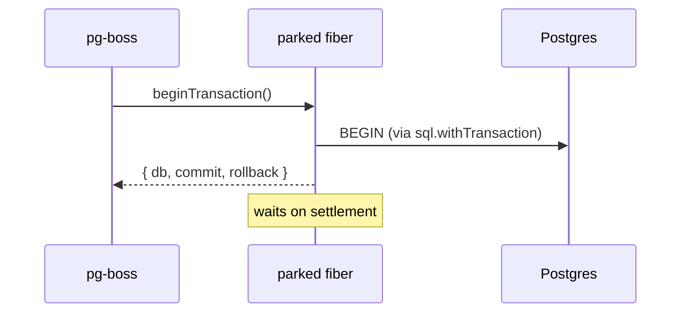

Step two: pg-boss calls the worker callback with `(jobs, tx)`. `tx` is the same `db` object. `WorkerTransaction.run(tx, handler)` looks up which parked fiber owns `tx` and submits the handler to it. The handler runs as a **child of the parked fiber**, with the transaction's services (including `transactionService`) layered over the worker layer's context. Every `sql` statement in the handler goes to `conn`. A nested `withTransaction` becomes a savepoint. A `ChargeCard.send()` inside the handler finds `transactionService`, gets `dbFor(conn)`, which is the very `tx` pg-boss handed out, so pg-boss recognises it.

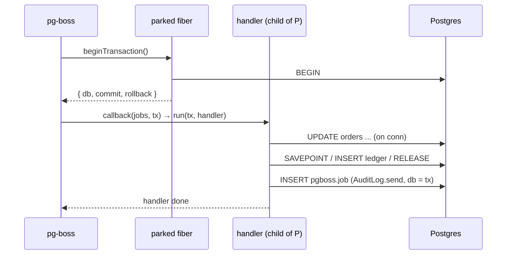

Step three: pg-boss marks the jobs completed through `tx` and calls `commit()`. `commit()` completes `settlement` with `"commit"`. The body returns, so `withTransaction` sends a real `COMMIT` and returns the connection to the pool. `commit()` resolves when the parked fiber exits. On `rollback()`, the body fails on purpose, so `withTransaction` sends `ROLLBACK`.

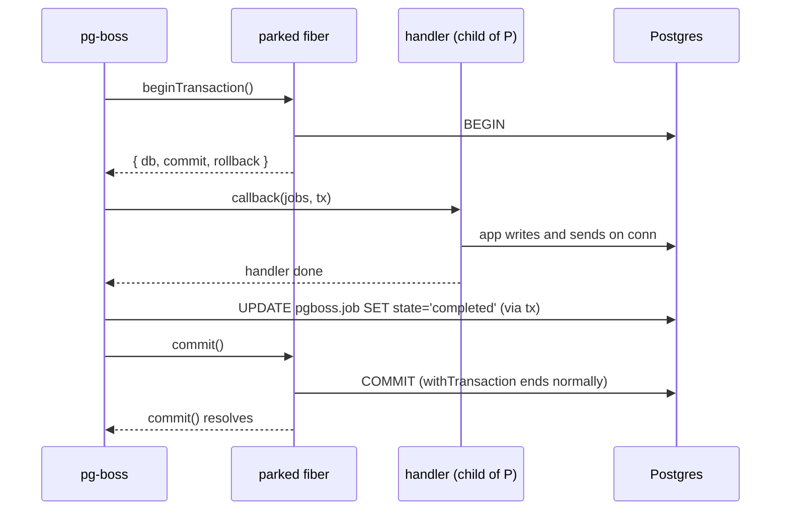

Because the transaction really is an Effect `withTransaction`, everything Effect promises about transactions holds inside a worker: savepoints, rollback on failure or interruption, and rows decoded the native way.

The safety rules around it:

- A rollback interrupts the handler child and **waits** for it before `ROLLBACK` runs. So no late handler statement can land on the connection after it goes back to the pool and belongs to someone else.
- `rollback()` never rejects, is safe to call twice, and gives up after `rollbackTimeout` (5 s by default), as pg-boss requires.
- Once settled, the transaction's `db` rejects every further statement.
- The parked fibers live in the `PgBoss` layer's `FiberSet`, so closing the layer interrupts any still open, and they roll back.

### 10.7 Add the pool budget

A transactional batch holds one `PgClient` connection for its whole run. A worker with `localConcurrency: 3` can hold three. If workers took every connection, your HTTP requests would wait. So each transactional worker layer **reserves** `localConcurrency` connections from a budget of `maxConnections - connectionReserve` (default reserve 2). If the reservation does not fit, the layer fails to build with a message, instead of the app stalling later at run time (`src/internal/runtime.ts`).

### 10.8 The whole picture

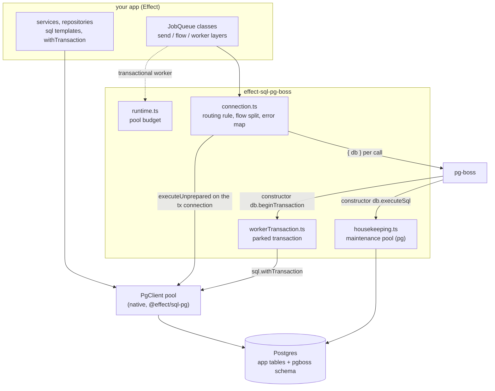

### 10.9 Shutdown order

When the app's layers close:

1. Each worker layer calls `offWork(name, { wait: true })`, so it returns only after its batch in flight settles. If that takes longer than the stop timeout, the worker interrupts its own handlers (a transactional one rolls back) and waits again. Worker layers close before `PgBoss.layer` and before the services their handlers use, so a handler never sees its services closed under it.
2. `PgBoss.layer` calls `boss.stop({ graceful: true, close: false })`.
3. The `FiberSet` interrupts any leftover parked transactions. They roll back.
4. The maintenance pool ends.

---

## 11. Two walkthroughs, statement by statement

These use the example from `design/README.md`.

### 11.1 `placeOrder`: enqueue inside the app's transaction

```ts
sql.withTransaction(Effect.gen(function*() {
	const [order] = yield* sql`insert into orders ${sql.insert(cart)} returning id`
	const jobs = yield* JobQueue.flow({
		charge: ChargeCard.step({ orderId: order.id, amountCents: cart.totalCents }),
		ship: ShipOrder.step({ orderId: order.id }, { dependsOn: ["charge"] })
	})
	yield* sql`update orders set charge_job_id = ${jobs.charge} where id = ${order.id}`
}))
```

What happens, in order:

1. `withTransaction` reserves native connection `c1`, sends `BEGIN`, and puts `[c1, 0]` in the fiber's context.
2. The `insert into orders` statement finds `[c1, 0]` and runs on `c1`.
3. `JobQueue.flow` encodes each payload with its Schema, then calls `withDb`. The fiber is in a transaction, so it gets `dbFor(c1)`.
4. It calls `boss.flow(jobs, { db })`. pg-boss builds three statements (insert the charge job, insert the ship job, insert the dependency) and calls `db.executeSql(script)` once, with no values.
5. `executeSql` sees `values === undefined`, splits on `";\n"`, and runs three `executeUnprepared` calls on `c1`. The job ids come back.
6. The `update orders` statement runs on `c1`.
7. The body succeeds. `withTransaction` sends `COMMIT` on `c1`. The order and both jobs become visible at the same moment.

If step 6 failed, `withTransaction` would send `ROLLBACK`, and the jobs would vanish with the order. No worker would ever see them.

### 11.2 `ChargeCardWorker`: write app tables inside pg-boss's transaction

```ts
ChargeCard.worker(
	Effect.fn(function*(jobs) {
		const sql = yield* SqlClient.SqlClient
		for (const job of jobs) {
			yield* sql`update orders set status = 'charged' where id = ${job.data.orderId}`
			yield* sql.withTransaction(sql`insert into ledger ...`)
			yield* AuditLog.send({ orderId: job.data.orderId, event: "charged" })
		}
	}),
	{ transactional: true, batchSize: 10, localConcurrency: 2 }
)
```

What happens, in order:

1. When the layer builds, it reserves 2 connections from the budget and calls `boss.work("charge-card", { transactional: true, ... }, callback)`.
2. pg-boss polls through the maintenance pool and claims up to 10 jobs (`SKIP LOCKED`).
3. pg-boss calls the constructor `db.beginTransaction()`. The library forks the parked fiber. `withTransaction` reserves native connection `c2` and sends `BEGIN`. pg-boss gets `{ db: dbFor(c2), commit, rollback }`.
4. pg-boss calls `callback(jobs, tx)`. The library decodes each job's payload with the Schema, then submits the handler to the parked fiber.
5. `update orders` finds `[c2, 0]` in the context and runs on `c2`.
6. The nested `withTransaction` sends `SAVEPOINT effect_sql_1` on `c2`, inserts into `ledger`, and sends `RELEASE SAVEPOINT`.
7. `AuditLog.send` calls `withDb`, finds `[c2, 0]` (the savepoint has ended), and gets `dbFor(c2)`, the same object pg-boss knows as `tx`. The audit job is inserted on `c2`.
8. The handler resolves. pg-boss marks the 10 jobs completed through `tx`, on `c2`.
9. pg-boss calls `commit()`. The parked body returns, `withTransaction` sends `COMMIT` on `c2`. Order updates, ledger rows, the audit job and the job completions commit together.

If the handler fails at step 6, pg-boss calls `rollback()`. The library interrupts what is left of the handler, `withTransaction` sends `ROLLBACK`, and pg-boss marks the 10 jobs `retry` through the maintenance pool. Nothing the handler wrote survives.

A worker that calls an external API (a card processor, say) should usually be `transactional: false`. Otherwise it holds a connection and an open transaction while it waits on the network.

---

## 12. Reading the code

A suggested order, smallest idea first:

1. `design/problem.md`: the problem in the author's own words.
2. `packages/effect-sql-pg-boss/src/internal/connection.ts`: the routing rule, `dbFor`, `runScript`, error mapping. About 150 lines, and the rest builds on it.
3. `src/internal/housekeeping.ts`: the maintenance pool. Short.
4. `src/PgBoss.ts`: how the layer wires pg-boss's constructor `db` to housekeeping and to the parked transaction.
5. `src/internal/workerTransaction.ts`: the parked transaction. Read the header comment's diagram first, then `begin`, then `run`, then `workCallback`.
6. `src/internal/runtime.ts`: the pool budget.
7. `src/JobQueue.ts`: the public queue API. Most of its length is types. The runtime parts are `send`, `flow`, `worker` and `convergeQueue`.
8. `test/workerTransaction.test.ts` and `test/jobQueue.test.ts`: the behaviour, proved against a real Postgres.

For the dependencies:

- `node_modules/effect/src/sql/SqlClient.ts`: search for `getConnection` and `makeWithTransaction`.
- `node_modules/@effect/sql-pg/src/PgClient.ts`: `make`, `makeImpl`, `listen`, `notify`.
- `node_modules/pg-boss/dist/db.js`: pg-boss's own `Db`, especially `beginTransaction`. It is the reference the library imitates.
- `node_modules/pg-boss/dist/manager.js`: search for `beginTransaction` to see how a transactional worker drives a batch, and for `statements.join` to see the flow script.

---

## 13. Glossary

| Term                 | Meaning                                                                                                                        |
| -------------------- | ------------------------------------------------------------------------------------------------------------------------------ |
| Batch                | The jobs one worker fetch returns. The handler gets them together, and in a transactional worker they commit or fail together. |
| BAM                  | pg-boss's runner for slow background schema migrations.                                                                        |
| Constructor `db`     | The `Db` passed to `new PgBoss({ db })`. pg-boss runs its own work on it.                                                      |
| `Db` / `IDatabase`   | pg-boss's driver interface: `executeSql`, optional `beginTransaction`, optional `listen`.                                      |
| Dead-letter queue    | A queue that receives copies of jobs that failed for good.                                                                     |
| Extended protocol    | `Parse`/`Bind`/`Execute`. One statement, parameters, can be prepared. The only protocol the native driver speaks.              |
| Flow                 | A set of jobs plus dependency edges, inserted together.                                                                        |
| Maintenance pool     | The library's small node-postgres pool for pg-boss's own statements.                                                           |
| Native driver        | `@effect/sql-pg` 4.x, which implements the Postgres wire protocol itself.                                                      |
| node-postgres / `pg` | The common Promise-based Postgres driver for Node. pg-boss's default.                                                          |
| Parked transaction   | A fiber waiting inside `sql.withTransaction` until pg-boss calls `commit()` or `rollback()`.                                   |
| Per-call `{ db }`    | The option that makes one pg-boss call run on a given connection, so it joins that connection's transaction.                   |
| Prepared statement   | A parsed statement the server keeps under a name and reuses.                                                                   |
| Savepoint            | A marker inside a transaction you can roll back to without ending the transaction. Nested `withTransaction` uses them.         |
| Simple protocol      | One `Query` message with SQL text. May hold several statements. No parameters.                                                 |
| `SKIP LOCKED`        | Postgres row-locking mode that skips rows another transaction holds. Lets many workers fetch without collisions.               |
| `transactionService` | The `Context.Service` holding `[connection, depth]` for the fiber's current Effect transaction.                                |
| `tx`                 | The `db` of the transaction pg-boss opened for a transactional worker's batch. pg-boss tracks it by identity.                  |
